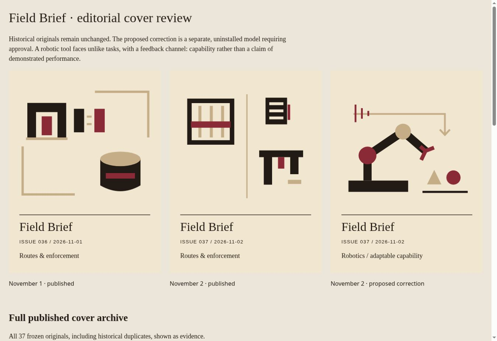

# Field Brief cover selection — review and approved issue 037 correction

> **Correction status:** The version-6 “Robotics / adaptable capability” artwork was explicitly authorized to replace the issue 037 landing-page cover on November 2, 2026. The original frozen pin is retained as `original-published-pin.json`; the approved artwork source remains `proposal.svg`. The code and cover updates are separate from the original PR #39 review. See the follow-up PR for release/deployment status.

Baseline: `2926414b6233f738795180b40a1475444b609467` (37 Field Brief editions).
At the original review baseline, neither correction was deployed. The systemic correction has since been merged through PR #39. On November 2, the user explicitly authorized installing the prepared artwork for issue 037. The follow-up change applies it to the canonical Field Brief pin and Periodicals shelf while preserving the original in `original-published-pin.json`. Merge/deployment status is tracked by the follow-up PR, not assumed by this report.

## Findings

- Ten covers carry **Routes & enforcement**; eight carry **Exposure & resilience**. Sixteen covers since October 18 include nine three-motif studies. Repetition is not confined to November 1–2.
- October 26 and November 2 both use separate-registers and inspection-screen; October 27 and November 1 both use licensed-opening. November 1 and 2 have different paths and signatures but repeat the same caption and three-symbol idiom.
- The old selector assigns framing prose 5 points, title 3, and each matched story 1. `legal`, `regulat` and `voter` are broad enforcement matches. It searches nested editorial JSON as prose. A matched category supplies a fixed phrase. It does not rank lead-story relevance.
- The existing geometric validator accepts November 2 against 36 predecessors. Closest normalized silhouette: October 26, 0.4552. No existing geometric threshold was exceeded; neither editorial caption nor layout family was a rejection criterion.
- Historical exact duplicates also remain evidence: October 7/11/17, October 5/16, October 9/14 and October 10/15. None is repaired.

## Prospective change

Headline/lead matches now outweigh synthesis and secondary headline matches (12/10/2/1). Nested editorial/source records are not treated as prose. Capacity/capability includes robotics and investment; disclosure/compensation supports evidence. Generic legal/regulatory/voter words no longer establish an enforcement mechanism by themselves. This remains a deterministic, inspectable vocabulary, not semantic understanding or a claim that every issue has a unified thesis.

Captions use words from the headline plus the authored treatment, rather than one phrase per broad category. Single-scene and unequal two-part spreads are preferred to three-symbol studies. Twelve additional authored mechanisms broaden the vocabulary. A lead/headline-supported robotics composition depicts an articulated tool, unlike tasks and feedback; it is not an assertion of realized productivity.

New models use version 6 and editorial policy 2. In addition to unchanged full-history geometry, signature, .90 silhouette and .82 recent-silhouette checks, treatment review rejects repeated captions or composition families among the previous three editions, overlapping recent motif pairs, and same-subject/same-family motif pairs across the archive. Legacy IDs supply history descriptors without editing pins. New dates after November 2 receive these checks even if a supplied model attempts to downgrade its version. Frozen history remains readable under its original policy; explicit `issueTreatment()` audits expose its editorial shortcomings.

The maximum of 96 expensive geometry reviews remains. Cheap treatment filtering happens first, so rejected caption/layout combinations do not consume that budget. Exhaustion stops clearly and requires another authored treatment. No duplicate fallback, approval gate, paid service, network dependency, schedule change or automation modification is introduced. Existing preparation validates before writing; the simulated failure test verifies the authored draft, all registries and hub remain byte-identical after failure. A blocked release is still possible with a finite vocabulary; uninterrupted future publication cannot be guaranteed indefinitely.

## November 2 artwork correction — explicitly approved

[Comparison](comparison.jpg): November 1 original, November 2 original, proposed November 2 correction.



`proposal.json` records the approved versioned model and original baseline. `proposal.svg` now matches the corrected frozen pin in `personal-updates/issue-mark-archive.js` and the Periodicals landing-page fallback. The exact previously published pin is preserved in `original-published-pin.json`; Git history also retains it. The correction was explicitly authorized on November 2, 2026 and does not change any Field Brief story, number, publication timestamp, or historic unrelated artwork.

Proposed caption: **Robotics / adaptable capability**. Normalized silhouette maximum against 36 earlier issues: 0.2880. Independent Sharp SVG rasterization against all 37 covers (144×144 palette-aware foreground masks): proposal/November 1 IoU 0.0990, proposal/November 2 0.0936; original adjacent-pair IoU 0.2547; maximum proposal/archive IoU 0.2643. These are complementary diagnostics, not a perceptual guarantee or newly relaxed production thresholds.

The local Chrome comparison and full archive gallery were visually inspected. Phone-width review has no horizontal overflow (378px client/scroll at a 393px frame). This is local rendered-artwork QA, not deployment, physical iPhone or Safari verification. Preview typography may use local serif fallbacks; production font declarations are unchanged.

Reproduce the full archive gallery and proposal outside production paths:

```sh
node scripts/review_field_brief_cover.cjs /tmp/field-brief-cover-review
node scripts/test_field_brief_cover_render.cjs
```

The optional raster audit uses Sharp already supplied by the QA environment. It is not added as a site/publisher dependency.

## Validation actually executed

| Command (`node scripts/…`) | Result |
|---|---|
| `test_field_brief_editorial_cover.cjs` | 37 checks; headline/noise, known failure, captions/motifs/families, 20 isolated repeated-subject editions, exhaustion without writes |
| `test_field_brief_cover_originality.cjs` | 419 checks; 48 repeated-theme covers, geometric disguises, append-only preparation, invalid pins, retry |
| `test_field_brief_cover_render.cjs` | pass; rendered comparison across 37 covers |
| `test_field_brief_operations.cjs` | 103 checks |
| `test_publishing.cjs` | pass; idempotent preparation and publication integrity |
| `test_art_originality.cjs` | 529 checks |
| `test_art_append_growth.cjs` | 234 growth checks; nested suites 541 artwork and 314 Workbook checks; 38/15/7 synthetic editions |
| `test_periodicals.cjs` | pass; routing, shelf, Heron, resume and interaction handlers |
| `test_daily_schedule.cjs` | 138 checks |
| `test_workbook_cadence.cjs` | 1010 checks |
| `test_workbook_marks.cjs` | 302 checks |
| `test_workbook_learning.cjs` | 283 checks, 112 authored question pairs |
| `test_notebook.cjs` | 267 checks |
| `test_field_register.cjs` | 99 checks |
| `test_editorial_folio.cjs` | 159 checks |
| `test_reading_navigation.cjs` | pass |
| `test_issue_marks.cjs` | pass |
| `check_field_brief.cjs 2026-11-02` | complete; verify-deployment, no republish |

The shared growth fixture used a constant caption across successive private editions. Its caption now includes its private date; genuinely different test diagrams must still pass all real geometry thresholds. This fixes an introduced fixture failure without weakening production checks.

Five failures were independently reproduced on untouched baseline and this branch at the same assertions: `test_field_brief_artwork.cjs` (historical content snapshot), `test_polish.cjs` (Workbook canonical snapshot), `test_maintenance_20261009.cjs` (Commonplace snapshot), `test_final_regressions.cjs` (hub interaction snapshot), `test_identity_runtime.cjs` (colophon ordering). They remain unresolved pre-existing failures. Standalone browser-launch suites were not run; browser QA used the supported Chrome surface. `bundle exec jekyll build` could not run: `bundle: command not found` (exit 127). No build success is claimed. An initial editorial-review invocation supplied a date instead of its required JSON file; that usage error is not a product test failure.

`git diff --check` and JavaScript syntax checks pass. Published editions, every frozen cover/story plate and registry, all shared originality-helper bytes, L&L/Workbook content and artwork, schedules, automations, layouts, Heron, Commonplace and `/rupert/` are unchanged against baseline. No privacy-affecting storage, telemetry or network behavior was added. A full archive remains finite, and keyword-based editorial inference and geometric/raster comparisons retain limitations; visual editorial review remains valuable.
