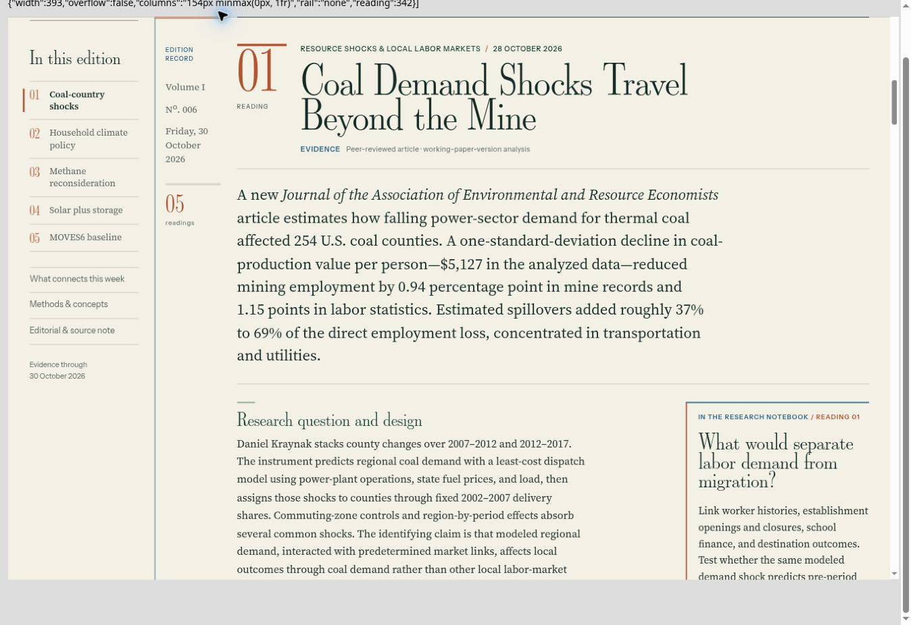

# L&L editorial rail — review only

Baseline: `2926414b6233f738795180b40a1475444b609467`. Independent of the Field Brief cover correction. Neither proposal is deployed.

## Composition

At 1440px and above: existing 184px chapter sidebar | 112px editorial rail | main readings, separated by 28px grid gaps. The existing 1462px maximum canvas is unchanged; the opening, hero, overview, closing sections and global navigation retain their presentation.

The rail contains only the existing volume/edition/date label and a derived reading count. No analysis, findings, new editorial claims or links are invented. It is static, with a river-ink vertical boundary, a fine double copper head rule, and a double hairline above the reading count, using the journal's existing typography/tokens; there is no new sticky/floating behavior, scripting, dependency or font. Future substantive content can occupy this same grid track. Current research notes stay within the main reading column in their original position.

Below 1440px the rail disappears and the established layout resumes. Existing tablet/phone and research-note breakpoints are untouched. Glance and print hide the rail. The publication-time composer derives the register for every edition and refreshes it idempotently when preparing future content.

## Visual evidence

[Desktop](desktop.jpg) · [Laptop](laptop.jpg) · [Phone](phone.jpg) · [Night](night.jpg).

These are actual local Chrome renders of the proposed source in sized iframes, not live production or physical-device screenshots. Wide frames are scaled to fit the QA browser window; their layout viewport remains the indicated width.

| Viewport | Edition tracks | Main reading width | New rail | Horizontal overflow |
|---|---|---:|---|---|
| 1512 | 184 / 112 / 1072px | 1072px | shown | none |
| 1440 | 184 / 112 / 1000px | 1000px | shown | none |
| 1280 | 184 / 964px | 964px | hidden | none |
| 1180 | 154 / 893px | 893px | hidden | none |
| 820 | established single reading canvas | 769px | hidden | none |
| 393 | established single reading canvas | 342px | hidden | none |

All six widths audited in Day and Night; visually inspected desktop, laptop, intermediate, tablet and portrait presentations. Existing chapter links select the correct reading and update active state (02 / Household climate policy confirmed). Sticky navigation retains `position:sticky`, top 70px. Keyboard Enter and visible native focus were exercised. At a Glance hides all six rails; Full Edition restores the reading view. Existing figures and research notes were inspected; the solar/storage chart fits its analysis column and preserves its caption. No article copy or headings were changed.

## Source validation

- `node scripts/test_editorial_rail.cjs`: 24 checks. Removing only the rails and reverting the CSS cache key restores the complete baseline journal byte-for-byte. Existing scripts, content, IDs, reading links, notes, figures, artwork, opening and closing markup remain exact. Real DOM sibling order is sidebar/rail/readings. Future metadata refresh and retry are idempotent.
- `node scripts/test_editorial_folio.cjs`: 159 checks.
- `node scripts/test_publishing.cjs`: passed, including idempotent preparation.
- `node scripts/test_periodicals.cjs`: passed.
- `node scripts/test_reading_navigation.cjs`: passed.
- `node scripts/test_notebook.cjs`: 267 checks.
- `node scripts/test_field_register.cjs`: 99 checks.
- `node scripts/test_daily_schedule.cjs`: 138 checks.
- `node scripts/test_art_originality.cjs`: 529 checks.
- `git diff --check`: passed.

Print rules are source-verified; a rendered print preview was not performed. Safari, physical iPhone and an independent Jekyll build were not tested; Bundler is unavailable in this environment. Existing broad snapshot/identity failures and their unchanged-production comparison are documented in the separate Field Brief review; this work does not repair them or claim they pass.

Only journal HTML, its reading-folio stylesheet, its publication-time composer, the targeted test and this review evidence are changed. `refinement.css`, all Notebook/Field Brief/Workbook sources, frozen art registries, historical scholarship, schedules, automations, Heron, Field Notes/Register and `/rupert/` remain untouched. Separate branches allow either proposal to be reviewed and released independently.
